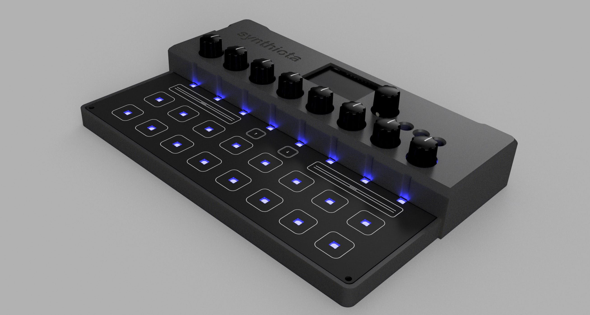
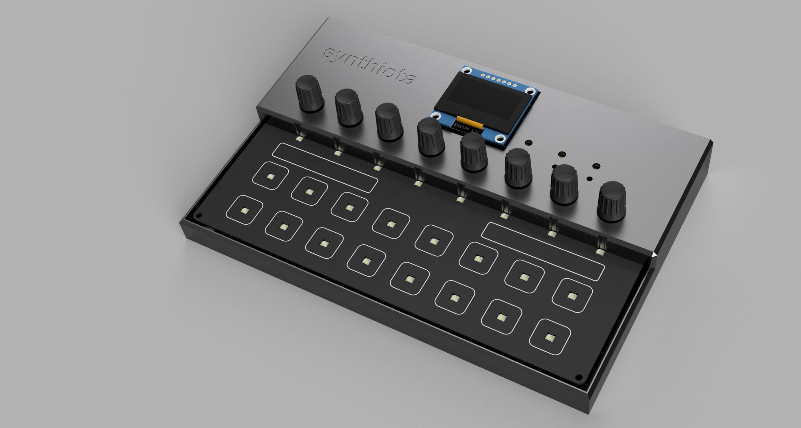
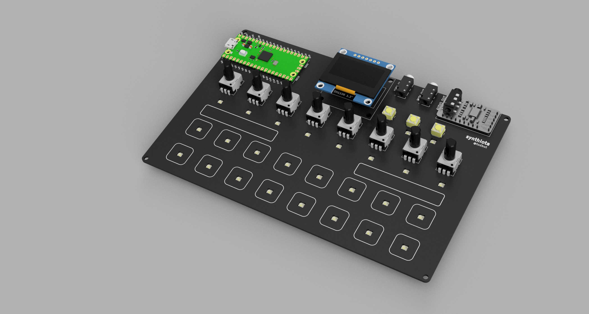
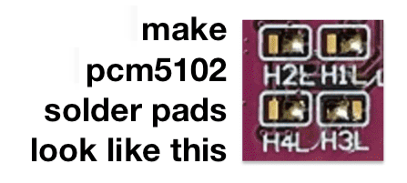
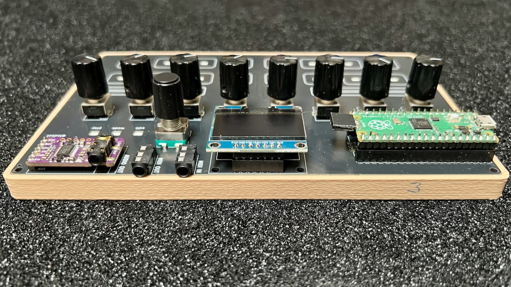
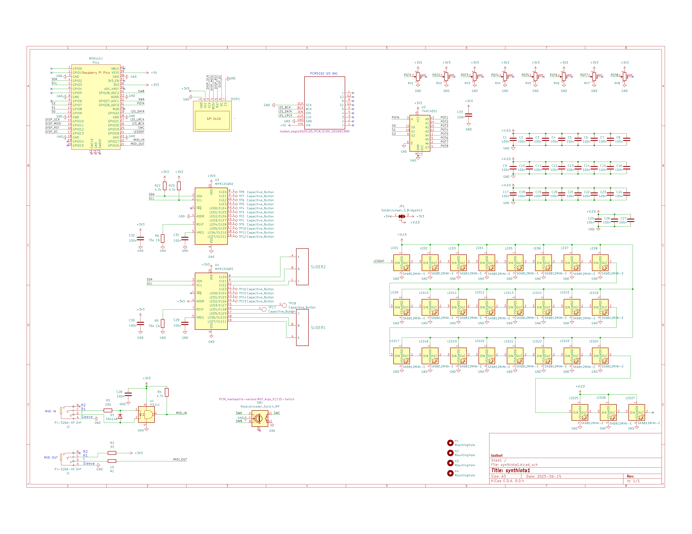

# synthiota

Pico/Pico2-based board for playing with synthesizers in CircuitPython.

https://github.com/user-attachments/assets/1fe45b23-2a2a-41f4-9afe-203840c703e8

## Video demos:

- "tbish" TB-303 like synth, demo2: https://youtu.be/MjE2wdevc3M
- "tbish" TB-303 like synth, demo1: https://youtu.be/O4a5pk78DVM

# Assembling

The PCBAs come with all SMD parts assembled. The components you will need to supply:

- 1 x Raspberry Pi Pico 2
- 1 x [PCM5102 I2S Stereo DAC](https://amzn.to/4nX4xkD)
- 1 x [SH1106 128x64 1.3" SPI OLED](https://amzn.to/4oUlOeM) 
- 2 x [PJ320A 3.5mm stereo jack](https://amzn.to/4i5F33d)
- 8 x [RK09K 10k vertical potentiometer](https://amzn.to/47XbwEk) (or similar)
- 1 x [EC11 rotary encoder](https://amzn.to/4o1vSSW)
- 2 x 20-pin 5 mm "short" header socket for Pico (see below)
- 1 x 7-pin 5mm "short" header socket for display (see below)
- 8 x knobs for pots
- 1 x knob for encoder

For the knobs, you can buy knobs off Amazon or you can 3d print them.
Some 3D printable knobs I like are [these 6mm Vintage Synth Knob](https://makerworld.com/en/models/2665733-6mm-vintage-synth-knob-80s-boss-style#profileId-2949654).

### PCM5102 DAC setup

Before soldering down the PCM5102 DAC, solder bridge the jumpers 
to be 1L/2L/3H/4L, as in this picture:

The PCM5102 DAC should have standard header pins soldered to it, on the 6-pin 
header row. For extra stability, you can also solder one of the G pins behind
the audio jack.

More inforomation about the PCM5102 can be found [in this blog post](https://todbot.com/blog/2023/05/16/cheap-stereo-line-out-i2s-dac-for-circuitpython-arduino-synths/).

### Hader sockets and header pins

You will also need some headers and header sockets to attach the modules to the PCB.
If using the [enclosure](./enclosure), the top part expects the header arrangement to be:

- Pico: 
  - [Short socket headers](https://www.adafruit.com/product/5585) for Pico on synthiota board
  - Standard header pins on Pico  (Pico H sold w/ these pins soldered)
- OLED display:
  - [Short socket headers](https://www.adafruit.com/product/5585) for OLED display on synthio  - Standard header pins on OLED display  (usually sold w/ these pins soldered)
ta board
- PCM5102 I2S DAC
  - Standard header pins on PCM5102 I2S DAC board (usually sold w/ these pins soldered)
  - I2S DAC w/ header pins is soldered directly to the synthiota board, no socket

When soldering down the jacks and sockets, holding them in place with masking tape
or blutack makes things easier. For the Pico header sockets, sticking them into 
a Pico and hold the Pico onto the board with masking tape or blutack can be helpful.

After soldering everything, the result will look like:

# Pico pins used

CircuitPython naming. See `hwtest/synth_setup_synthiota.py` for how they're used.

Encoder 

* `board.GP28`  - encoder B pin
* `board.GP27`  - encoder A pin

ADC input for pots

* `board.GP26`  - ADC input for pot knobs

I2S DAC 

* `board.GP22`  - I2S DAT pin to PCM5102 DAC
* `board.GP21`  - I2S LCK pin to PCM5102 DAC
* `board.GP20`  - I2S BCK pin to PCM5102 DAC

Encoder switch

* `board.GP19`  - encoder SW pin
 
NeoPixel LEDs
 
* `board.GP18`  - NeoPixel LEDs pin 
 
UART MIDI In/Out
 
* `board.GP17`  - UART RX pin to MIDI input
* `board.GP16`  - UART TX pin to MIDI output

SPI for display

* `board.GP13`  - SPI DC for SH1106 display
* `board.GP12`  - SPI RES for SH1106 display
* `board.GP11`  - SPI MOSI for SH1106 display
* `board.GP10`  - SPI SCK for SH1106 display

Pot mux select

* `board.GP9`   - SEL A pin to 4051 mux for pot knobs
* `board.GP8`   - SEL B pin to 4051 mux for pot knobs
* `board.GP7`   - SEL C pin to 4051 mux for pot knobs

I2C for MPR121 touch sensors

* `board.GP3`   - I2C SCL to MPR121 touch sensors
* `board.GP2`   - I2C SDA to MPR121 touch sensors

Free pins: GP0,GP1, GP4,GP5,GP6, GP14,GP15. Feel free to use for other purposes. 

# Schematics

(note most product links are Amazon affiliate links)

