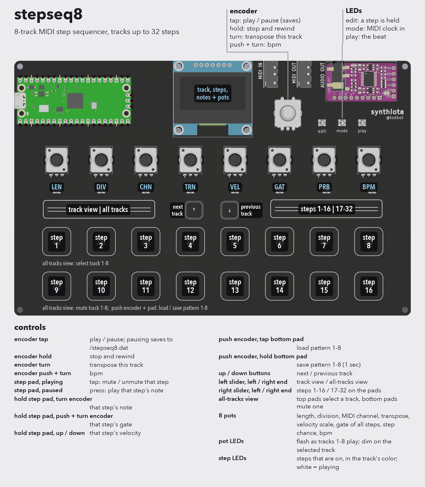

# stepseq8

An 8-track MIDI step sequencer, in the manner of
[picostepseq](https://github.com/todbot/picostepseq). It makes no sound of
its own, it plays other gear over USB and TRS MIDI. Like picostepseq, you
never have to stop playing to edit.

Each track plays one note at a time on its own MIDI channel (1-8 by
default). Tracks can be any length from 1 to 32 steps, with their own clock
division, so they can drift against each other and come back around.

The sequencing is synthtools' `StepSequencer`, one per track, all driven from
a shared clock. The screen borrows the look of
[monobit](https://github.com/DatanoiseTV/monobit).

## Controls

| action | control |
|---|---|
| play / pause | tap encoder |
| stop and rewind | hold encoder 1 sec |
| transpose this track | turn encoder |
| tempo | push + turn encoder |
| mute / unmute step (playing) | tap step pad |
| play step's note (paused) | press step pad |
| step's note | hold step pad, turn encoder |
| step's gate | hold step pad, push + turn encoder |
| step's velocity | hold step pad, tap up / down |
| next / previous track | up / down |
| steps 1-16 / 17-32 | right slider, left / right end |
| track view / all-tracks view | left slider, left / right end |
| load pattern 1-8 | push encoder, tap bottom-row pad |
| save pattern 1-8 | push encoder, hold bottom-row pad 1 sec |

The top row of pads is steps 1-8 and the bottom row is steps 9-16 (or 17-24
and 25-32). In the all-tracks view, the top row selects a track and the
bottom row mutes one.

### Pots

The pots edit the selected track. A value doesn't jump when you switch
tracks, the pot and the value converge as you turn.

| pot | | |
|---|---|---|
| 1 | LEN | length, 1-32 steps |
| 2 | DIV | steps are 32nds, 16th triplets, 16ths, 8th triplets, 8ths, ... |
| 3 | CHN | MIDI channel |
| 4 | TRN | transpose, same as turning the encoder |
| 5 | VEL | scales the velocity of every step |
| 6 | GAT | sets the gate of every step, replacing per-step gates |
| 7 | PRB | chance that a step plays |
| 8 | BPM | tempo, the same for all tracks |

## The screen

Track view's title shows the track and pattern (`TRACK 1 P1`) and the tempo.
Below are the steps, with the playing step filled and steps past the track's
length hatched out. A line marks the row the pads are on. Next are the notes
of that row: height is pitch, width is gate. A held step goes solid and its
number, note, velocity and gate replace the title.

The bars at the bottom are the pots, labeled LN DV CH TR VL GT PR BP. The fill
is the value, solid while you're turning it, and the tick is where the pot
physically is. The pot you're turning shows in the title, as `LEN 16`.

All-tracks view has a row per track: its number, `M` if muted, its steps and
its MIDI channel. It has no tempo or pot display.

## MIDI clock

stepseq8 sends Clock, Start, Continue and Stop while it runs on its own
tempo. If Clock, Start or Continue arrive on USB or TRS, it follows them
instead, `E` shows on screen and it stops sending clock. After a second
without clock, it goes back to its own tempo.

## Saving

Pausing writes everything to `/stepseq8.dat`, at most once every 20 secs:
the track you were working on, plus all 8 patterns. Saving to a pattern
while playing only takes effect on disk at the next pause, so pause before
powering off.

`boot.py` makes the drive writable from the board's side, so it must run:
reset the board after copying it. Don't save files to the drive from your
computer while stepseq8 is writing.

## Running it

Copy the contents of this directory to the root of `CIRCUITPY`, and install
libraries from `circuitpython/`:

    circup install -r requirements.txt

**This needs a `synthtools` newer than the current bundle**, with
`StepSequencer.trigger()` and `pause()`. Until that's released, copy
`synthtools/` from a checkout of
[CircuitPython_SynthTools](https://github.com/todbot/CircuitPython_SynthTools)
over the installed one.
